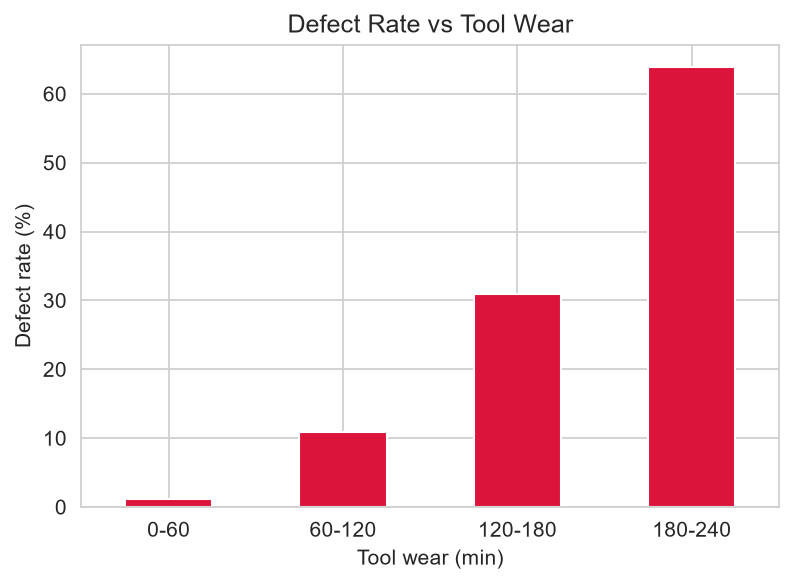
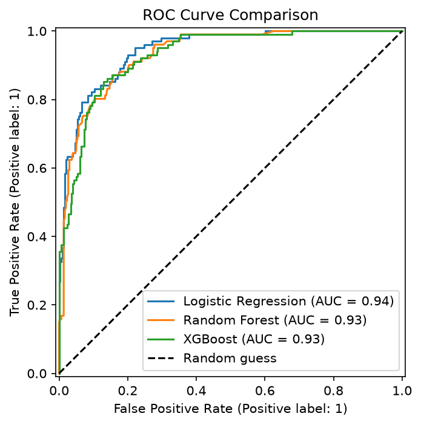
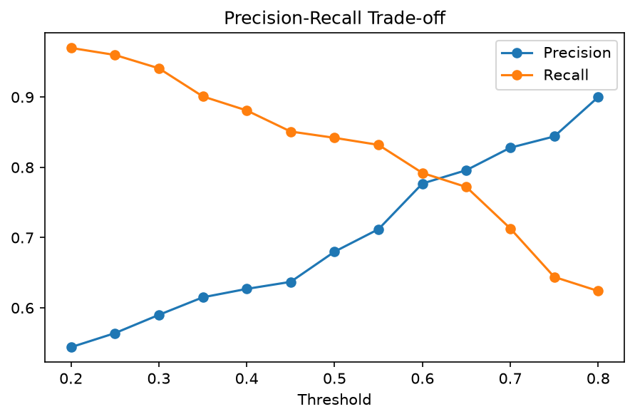
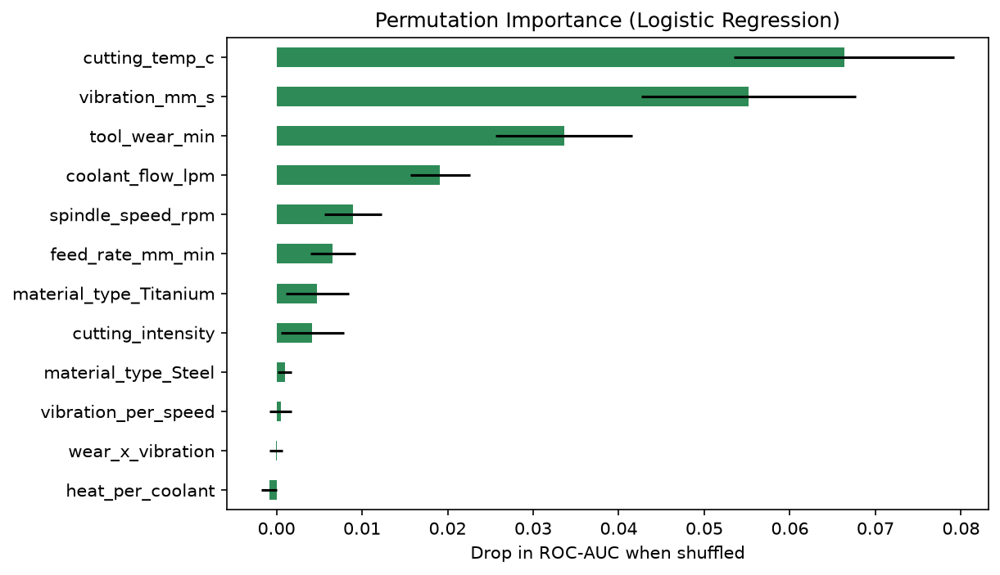
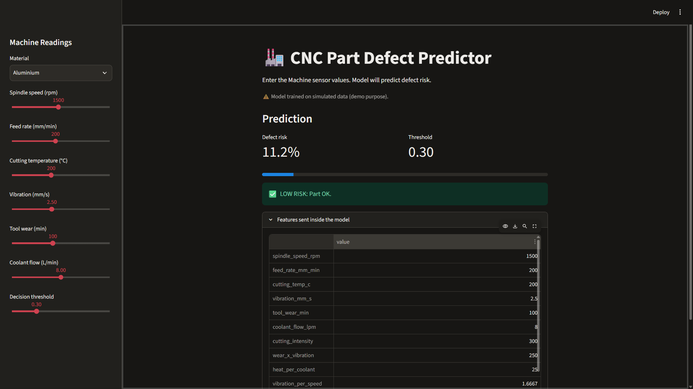

# 🏭 Manufacturing Quality Prediction & Defect Analysis

Predicting defective CNC-machined parts from machine sensor data, and turning model results into a business decision.

 **Data note:** The dataset is **synthetic**, generated using machining domain knowledge, because real factory data is confidential. Results show the pipeline, not real factory performance.

---

## 📌 Problem
Defective parts are costly. Inspecting every part takes time and money. This project predicts, from process readings, which parts are likely to be defective, so that only high-risk parts are flagged for inspection.

## 🛠️ Tech Stack
Python · Pandas · NumPy · Matplotlib · Seaborn · Scikit-learn · XGBoost · Streamlit · Git

## 🔄 Workflow
Data creation → Cleaning → EDA → Feature engineering → Modelling → Evaluation → Explainability → Streamlit app

## 📊 Dataset
2,000 parts (after cleaning) with these features:

| Feature | Description |
|---|---|
| `spindle_speed_rpm`, `feed_rate_mm_min` | Machine settings |
| `cutting_temp_c`, `vibration_mm_s` | Sensor readings |
| `tool_wear_min`, `coolant_flow_lpm` | Tool and coolant condition |
| `material_type` | Steel / Aluminium / Titanium |
| `defect` | Target (0 = good, 1 = defective), ~25% defective |

## 🔍 Key Insights from EDA
- Defect rate rises sharply with tool wear: **1.2% → 10.9% → 31.0% → 63.9%** across four wear bands (0–240 min)
- Titanium has the highest defect rate
- Vibration has the strongest correlation with defects



## 🤖 Models & Results
Features engineered from domain knowledge: `cutting_intensity`, `wear_x_vibration`, `heat_per_coolant`, `vibration_per_speed`.

| Model | Accuracy | Precision | Recall | F1 | ROC-AUC |
|---|---|---|---|---|---|
| **Logistic Regression** | 0.860 | 0.680 | **0.842** | 0.752 | **0.944** |
| Random Forest | 0.872 | 0.727 | 0.792 | 0.758 | 0.933 |
| XGBoost | 0.878 | 0.750 | 0.772 | 0.761 | 0.930 |

Logistic Regression was chosen for the highest recall, ROC-AUC and cross-validated F1, and for its interpretability.



## 💰 Business Impact
Assuming a missed defect costs ₹5,000 and a false alarm ₹500 (illustrative):

- Lowering the decision threshold from 0.5 to **0.2** reduced missed defects from **16 to 3**
- Total cost fell from ₹1,00,000 to **₹56,000 (~44% saving)**



## 🔎 Explainability
Top drivers (permutation importance): **cutting temperature, vibration, tool wear**, consistent with machining physics.



## 🖥️ Streamlit App
Enter sensor readings and get a defect-risk percentage with an adjustable threshold.



## ▶️ How to Run
```bash
git clone https://github.com/athipanraj2-glitch/manufacturing-quality-prediction.git
cd manufacturing-quality-prediction
python -m venv venv
source venv/Scripts/activate      # Windows Git Bash (Mac/Linux: source venv/bin/activate)
pip install -r requirements.txt
streamlit run app.py
```

## 📁 Project Structure
```
├── data/            raw and processed data
├── notebooks/       01 creation → 07 explainability
├── models/          saved models
├── reports/         charts
├── app.py           Streamlit app
└── requirements.txt
```

## ⚠️ Limitations & Future Work
- Synthetic data: patterns are cleaner than in a real factory, and the data was generated with near-linear logic, which favours Logistic Regression
- Threshold was tuned on the test set; production should use a validation set
- Imputation was fit on the full dataset; a production pipeline should fit it on training data only
- Next steps: real dataset, feature engineering inside the pipeline, drift monitoring

